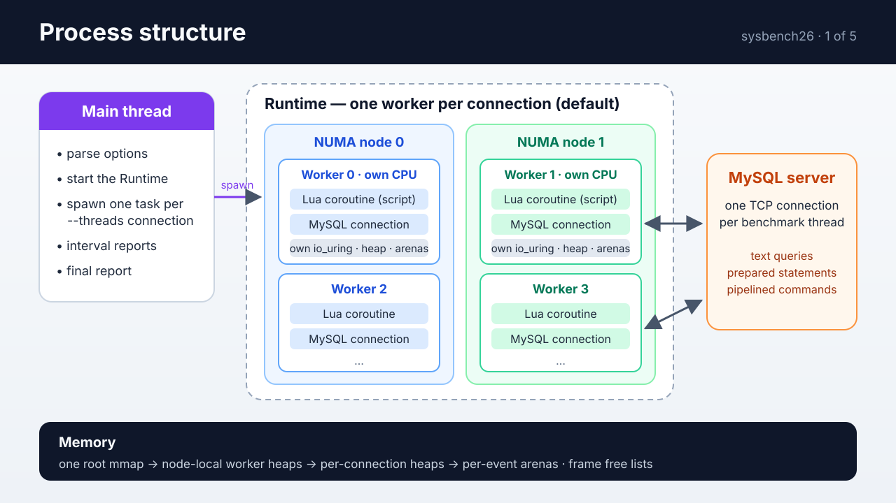
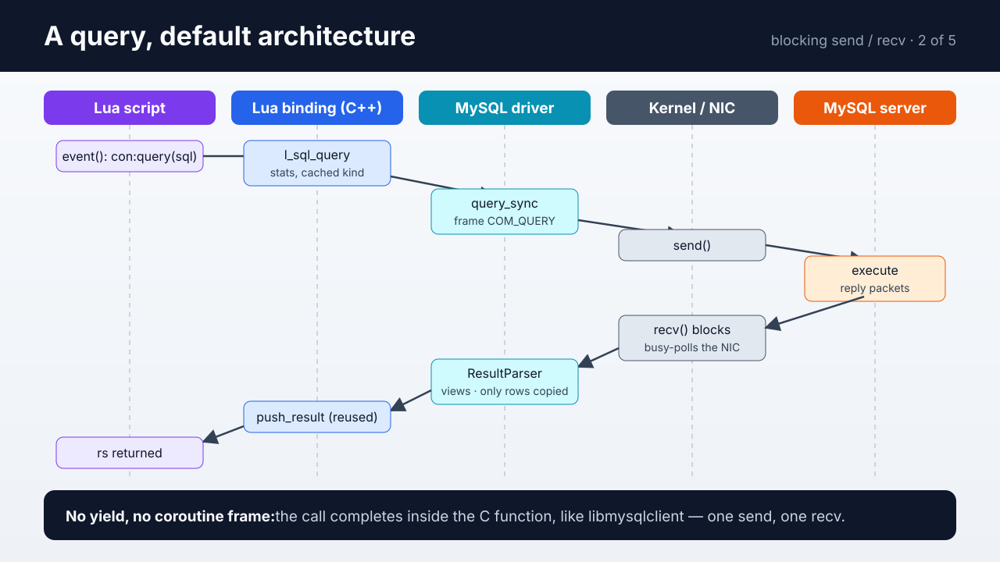
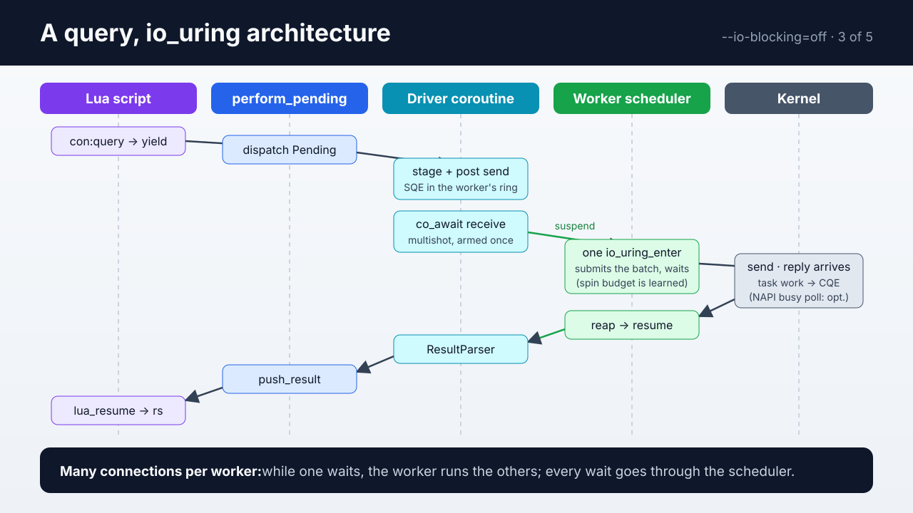
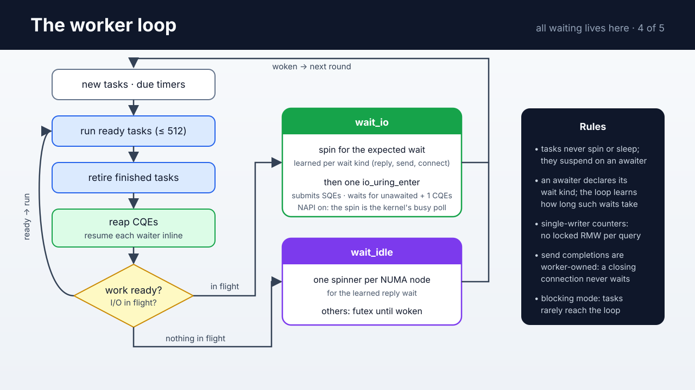
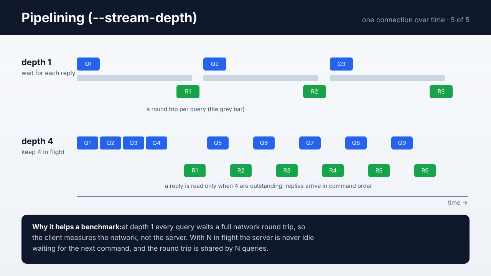

# Architecture

sysbench26 runs sysbench's Lua benchmarks against MySQL. Each benchmark
thread is one Lua coroutine with one connection.

## Process structure

- **Main thread.** It starts the Runtime, spawns one task per `--threads`
  connection, and prints the reports. It never runs benchmark code.
- **Workers.** The Runtime's worker threads are pinned per CPU, or per NUMA
  node when there are more workers than CPUs. Each one owns its tasks, its
  io_uring, its heap and its arenas, and a task never leaves its worker.
- **Memory.** One up-front `mmap` is carved into node-local worker heaps,
  per-connection heaps and per-event bump arenas. Coroutine frames come from
  per-thread free lists. Nothing per query reaches `malloc`.

## Two network architectures

| | `--io-blocking=on` (default) | `--io-blocking=off` |
|---|---|---|
| Workers | one per connection | one per `--connections-per-worker` (2) connections |
| Send | blocking `send()` | posted SQE, or a direct send (`--io-direct-send`) |
| Receive | blocking `recv()`; busy-polls via `net.core.busy_read` | multishot io_uring receive, armed once |
| Waiting | in the syscall | in the worker loop (slide 4) |

On a host with `busy_read` set, the blocking architecture has the shortest
round trip; it is the one sysbench uses. The io_uring architecture
serves many connections per worker.

## A query, default architecture

`con:query()` and `stmt:execute()` are LuaJIT FFI calls, as in
sysbench, so the JIT compiles them into the event loop's trace. They
complete inside the call, with no yield and no coroutine frame:
1. The command is framed into the connection's write buffer.
2. One `send()` and one `recv()` follow.
3. `ResultParser` fills the connection's result in place. Its rows are one
   flat array of fields, and nothing is returned or copied by value.

`param:set()` writes straight into the C parameter through the FFI, with no
call. Reply packets are views into the read buffer. Only row packets are
copied, and column definitions keep just their names.

A call that must wait (the io_uring architecture, pipelining, `--rate`, or a
fair yield between connections on one worker) records its request and
returns. The Lua wrapper then calls `coroutine.yield()`, and the Runtime
performs the request and resumes the coroutine. No OS yield is involved.

## A query, io_uring architecture

1. The Lua coroutine yields a pending request, and the driver coroutine
   issues it.
2. The task suspends on an awaiter, and the worker runs other connections.
3. A single `io_uring_enter` submits the batch and waits for the reply,
   asking for one CQE more than the unawaited sends in flight.
4. The reaped CQE resumes the task, and the same `ResultParser` builds the
   result.

## The worker loop

Only the scheduler waits. Tasks suspend on awaiters, and each awaiter
declares its wait kind (reply, send or connect).
- **Spin budget.** The loop times every awaited request and keeps a
  decaying-maximum estimate per kind. That estimate sets how long it spins
  before blocking.
- **NAPI.** With `--io-busy-poll=on`, the spin is the kernel's NIC busy poll.
- **Idle.** One idle worker per NUMA node spins; the rest wait on a futex.

## Pipelining: why streaming matters for benchmarking

Without streaming, every query costs a full network round trip, and the
client sits idle for it. On this setup that is about 37 µs for `SELECT 1`.
The same connection with 32 commands in flight sustains about 58K qps
(17 µs per query), against about 27K without streaming. So most of a
non-streamed query is network and client time, not database work, and the
server sits idle for much of each round trip, waiting for the next command. Reaching its
capacity needs many connections, each adding a server thread and contention
of its own.

`--stream-depth=N` (`con:pipeline(N)`) keeps N commands in flight on each
connection. MySQL answers a connection's commands in order, so replies are
read only once N are outstanding.
- **One round trip covers N queries,** so per-query cost falls toward the
  server's own work.
- **The server never waits** for the next command, so a benchmark reaches
  server throughput with few connections. For `SELECT 1` at 64 connections,
  depth 32 gives about 3.5× the qps of sysbench.
- **Fewer syscalls and wakeups per query,** on both client and server.

Use depth 1 to measure per-query latency, as an application does with one
request at a time. Use streaming to measure what the server can sustain. A
pipelined call returns an empty result, so scripts that read results must
not pipeline those queries. Any other call on the connection reads the
outstanding replies first.

## MySQL driver

- **Protocol support.** Text and prepared (binary) protocols,
  `caching_sha2_password` and `mysql_native_password`, and TLS
  (`--mysql-ssl`). The driver sits behind the protocol-neutral
  `db::Driver` / `db::Connection` / `db::PreparedStatement` interface.
- **Calls.** Every operation has an awaitable form. In the blocking
  architecture there are also synchronous `query_sync` and `execute_sync`,
  and pipelined `send_query`, `send_execute` and `read_reply`.

## Tools

- **`sb_netbench`.** Prepared or text `SELECT 1` on one connection, one
  layer at a time: raw blocking, raw io_uring, our driver (awaitable or
  synchronous), the paper-style io_uring client.
- **`tools/netbench_libmysql.cpp`.** The same loop on libmysqlclient, which
  is sysbench's driver.
- **`-DSYSBENCH_LAYER_STATS=ON`** prints cycles per query for each layer.
- **`-DSYSBENCH_TURNAROUND=ON`** prints the client's turnaround, from reply
  to next request.
